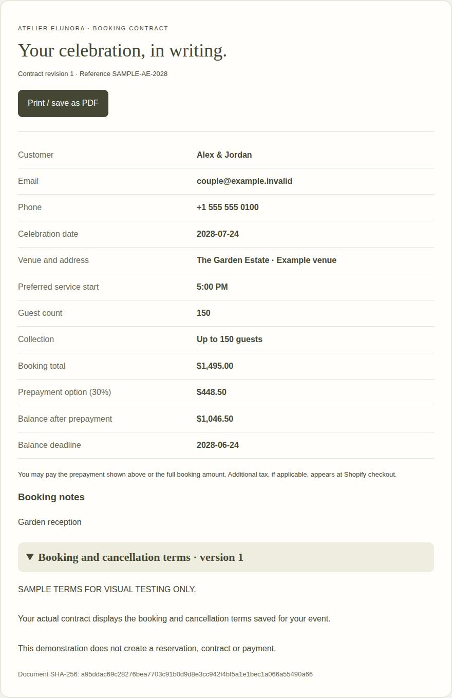
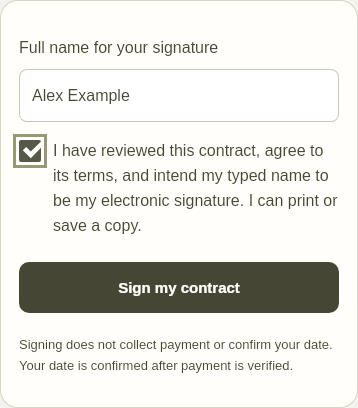
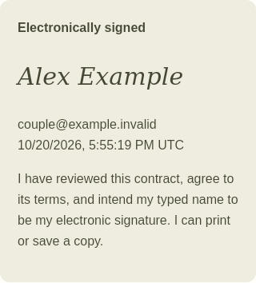
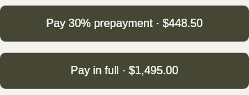
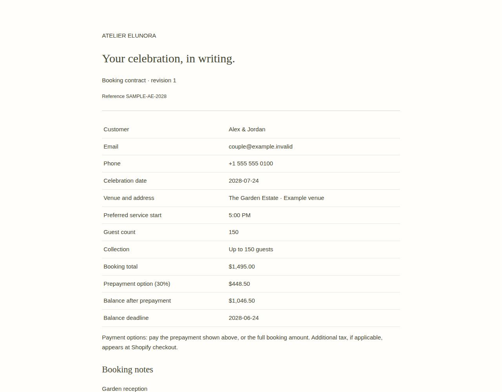

# Atelier Elunora booking contract — test screenshots

Captured October 20, 2026 from the actual customer portal, contract and signature components using sample data and sample terms.

- Product source: `d8efccf615bbb193ac00938dcf155071ec47241c`
- Visual test harness: `5f66c6e196bc852a9680dc86a0dd0e89caa08e32`
- [62 tests, typecheck and production build: passed](https://github.com/AtelierElunora/AtelierElunora-Website/actions/runs/39469754219)
- [Desktop Chromium and iPhone-sized WebKit checks: passed](https://github.com/AtelierElunora/AtelierElunora-Website/actions/runs/39469754205)

The browser checks verified exact 30%/70% amounts, payment buttons hidden before signing, required name and explicit consent, one saved signature, no payment or booking confirmation caused by signing, saved receipt, no horizontal overflow, and a printable copy without the private booking URL.

The visual fixture uses the actual signature helper with isolated in-memory records. Shopify, email, production database, and external services are disabled. This is browser emulation, not a physical iPhone test. No live customer booking, legal agreement, invoice, payment or email was created. The contract feature has not been deployed to Azure.

## 1. Review the generated contract

## 2. Enter a name and explicitly consent

## 3. View the saved signature receipt

## 4. Choose prepayment or full payment

## 5. Print or save a PDF
This screenshot shows the top of the printable document. The automated test also verified that the terms and saved signature are included below.

